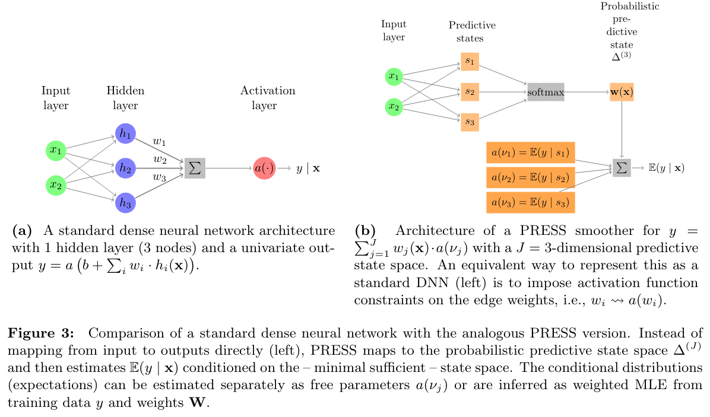

# pypress: Predictive State Smoothing (PRESS) in Python (`tf.keras`)


[](http://makeapullrequest.com)
[](LICENSE)


Predictive State Smoothing (PRESS) is a semi-parametric machine learning algorithm for
regression and classification on high-dimensional features. It learns a small number of
*predictive states*: soft clusters of observations that share the same predictive distribution
for the output. That gives you a neural network you can fit with `model.fit`, and a
kernel-smoother view of the same model that you can inspect. `pypress` implements the
algorithms of

* Goerg (2018) *[Classification using Predictive State Smoothing (PRESS): A scalable kernel
  classifier for high-dimensional features with variable
  selection](https://research.google/pubs/pub46767/)*.
* Goerg (2017) *[Predictive State Smoothing (PRESS): Scalable non-parametric regression for
  high-dimensional data with variable selection](https://research.google/pubs/pub46141/).*

## PRESS in a nutshell



A standard feed-forward network maps features $X$ to the output $y$ directly (left). PRESS
routes the prediction through $K$ predictive states $S$ (right): the network maps $X$ to state
probabilities $P(S = k \mid X)$ on a simplex, and each state has its own state-conditional
output distribution.


Given its predictive state, $y$ is independent of $X$. The states are therefore minimal
sufficient statistics for $y$: observations with similar predictive state weights have similar
predictive distributions, so you get **predictive clustering** for free. See
[docs/concepts.md](docs/concepts.md) for the full picture, including the smoother matrix $H$
and its degrees of freedom.

## Installation

`pypress` is distributed from GitHub only:

The deep-learning framework is an optional extra, so pick the backend you use:

```bash
# Keras / TensorFlow 2.16+
pip install "pypress[tf] @ git+https://github.com/gmgeorg/pypress.git"
# PyTorch 2.2+
pip install "pypress[torch] @ git+https://github.com/gmgeorg/pypress.git"
# or a specific release
pip install "pypress[tf] @ git+https://github.com/gmgeorg/pypress.git@v0.5.4"
```

The base install (`pip install git+https://github.com/gmgeorg/pypress.git`) has only
the framework-free modules, `pypress.analysis` and `pypress.clustering`, which need just
numpy and pandas. It requires Python 3.12+.

## Quick start

```python
import numpy as np
import tensorflow as tf

from pypress import analysis
from pypress.keras import callbacks, layers, regularizers, schedules

rng = np.random.default_rng(0)
X = rng.standard_normal((2000, 10)).astype("float32")
y = (X[:, 0] + 5 * X[:, 2] - np.exp(X[:, 4]) + rng.standard_normal(2000)).astype("float32")
y = (y - y.mean()) / y.std()  # standardize, so the penalty weights below are on the loss's scale

epochs = 40
reg = regularizers.CombinedRegularizer([
    # Guard: every state keeps at least 5% of the observations.
    regularizers.MinStateSize(l2=5.0, min_share=0.05, ema_decay=0.95),
    # Complexity: let states differentiate first, then prune toward 4 effective states.
    regularizers.DegreesOfFreedom(
        l2=schedules.ScheduledValue(start=0.0, end=2.0, duration_epochs=epochs // 2),
        target=4.0,
        ema_decay=0.95,
    ),
])

press = layers.PRESS(
    units=1, n_states=9, predictive_state_simplex_kwargs={"activity_regularizer": reg}
)
model = tf.keras.Sequential([tf.keras.Input(shape=(X.shape[1],)), press])
model.compile(loss="mse", optimizer=tf.keras.optimizers.Nadam(learning_rate=0.01))
model.fit(X, y, epochs=epochs, batch_size=256, verbose=0,
          callbacks=[callbacks.RegularizerScheduler()])  # advances the schedule

# Predictive clustering: inspect the learned states.
W = press.predictive_states(X).numpy()           # (n, K) predictive state weights
print(analysis.state_size(W, normalize=True))   # state shares
print(analysis.degrees_of_freedom(W))           # trace(H), the effective number of states
print(press.state_conditional_means.numpy())    # one mean per state
```

For classification, use `activation="sigmoid"` (or `"softmax"` with `units` = number of classes)
and a matching loss. [`notebooks/demo.ipynb`](notebooks/demo.ipynb) has end-to-end regression and
classification examples.

## What's in the box

| Module | Contents | Guide |
| --- | --- | --- |
| `pypress.keras.layers` | `PRESS`, or its parts `PredictiveStateSimplex` + `PredictiveStateMeans`; `PredictiveStateParams` for state-conditional distribution parameters | [docs/layers.md](docs/layers.md) |
| `pypress.keras.regularizers` | Penalties on the predictive state weights: `DegreesOfFreedom`, `MinStateSize`, `StateSizeEntropy`, `TargetEntropy` / `Uniform`, and `CombinedRegularizer` | [docs/regularizers.md](docs/regularizers.md) |
| `pypress.keras.schedules`, `callbacks` | `ScheduledValue` and `RegularizerScheduler`, to anneal any penalty setting over epochs | [docs/regularizers.md](docs/regularizers.md#scheduling) |
| `pypress.keras.initializers` | Initialization from original-scale values, and from the outputs (`initialize_from_y`) | [docs/layers.md](docs/layers.md#initialization) |
| `pypress.analysis` | Post-hoc analysis of fitted states: state sizes, smoother matrix, degrees of freedom, per-state summaries | [docs/analysis.md](docs/analysis.md) |

## Documentation

* [docs/concepts.md](docs/concepts.md): how PRESS works, and how it compares to mixture
  density networks.
* [docs/layers.md](docs/layers.md): the layers, initialization, and saving models.
* [docs/regularizers.md](docs/regularizers.md): what each regularizer controls and how to tune
  and schedule it.
* [docs/analysis.md](docs/analysis.md): interpreting a fitted model.
* [CONTEXT.md](CONTEXT.md): glossary of the terms used throughout.
* [CHANGELOG.md](CHANGELOG.md): release notes.

## Citation

If you use `pypress`, please cite the papers:

```bibtex
@techreport{goerg2017press,
  title       = {Predictive State Smoothing ({PRESS}): Scalable non-parametric regression
                 for high-dimensional data with variable selection},
  author      = {Goerg, Georg M.},
  institution = {Google},
  year        = {2017},
  url         = {https://research.google/pubs/pub46141/}
}

@techreport{goerg2018press,
  title       = {Classification using Predictive State Smoothing ({PRESS}): A scalable
                 kernel classifier for high-dimensional features with variable selection},
  author      = {Goerg, Georg M.},
  institution = {Google},
  year        = {2018},
  url         = {https://research.google/pubs/pub46767/}
}
```

## Development

```bash
poetry install
poetry run pytest pypress/tests/ -v
poetry run ruff check --fix . && poetry run ruff format .
```

Pre-commit hooks (ruff, markdownlint, codespell, interrogate) run on commit; see
[`.pre-commit-config.yaml`](.pre-commit-config.yaml).

## License

MIT; see [LICENSE](LICENSE).
