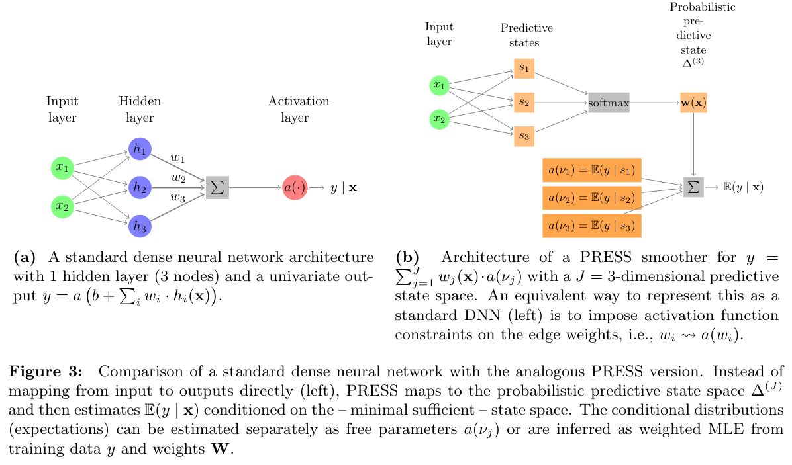

# How PRESS works

This page explains the model behind `pypress`. The terms in **bold** are defined in the
glossary, [CONTEXT.md](../CONTEXT.md).

## From a feed-forward network to predictive states

*Architecture of a standard feed-forward network (left) and of PRESS (right), adapted from
Goerg (2018).*

In a typical prediction problem we model the conditional distribution $p(y \mid X)$, or the
conditional expectation $E[y \mid X]$. A standard feed-forward network estimates it by mapping
the features $X$ to the output through a stack of non-linear transformations.

PRESS instead decomposes the predictive distribution into a mixture over $K$ **predictive
states** $S$:

The second equality is the defining property: given its predictive state $k$, the output $y$ is
conditionally independent of the features $X$. The state captures everything in $X$ that matters
for predicting $y$.

In `pypress` the two factors are two layers:

* `PredictiveStateSimplex` maps $X$ to the **state probabilities** $P(S = k \mid X)$, a softmax
  over the $K$ states. For a batch of observations these form the **predictive state weights**
  $W$, an $n \times K$ matrix whose rows sum to 1.
* `PredictiveStateMeans` holds one **state-conditional mean** $\mu_k$ per state and returns the
  **predictive mixture** $\hat{y} = W \mu$. `PredictiveStateParams` generalizes this to several
  **state-conditional parameters** per state, such as a mean and a standard deviation.

`PRESS` is a single layer wrapping both.

## Why it is useful

**Predictive states are minimal sufficient statistics for $y$.** They compress $X$ as much as
possible while keeping all of its predictive information.

That gives **predictive clustering**. Once the map from $X$ to the simplex is learned,
observations with similar predictive state weights are guaranteed to have similar predictive
distributions for $y$. You can group observations by what they predict, rather than by how
similar their raw features are. [analysis.md](analysis.md) shows how to inspect a fitted model
this way.

## The smoother matrix and degrees of freedom

PRESS is also a kernel smoother. The fitted values are a linear function of the observed outputs,
$\hat{y} = H y$, through the **smoother matrix**

$$H = W \cdot \operatorname{colnorm}(W)^\top,$$

where $\operatorname{colnorm}$ divides each column of $W$ by its **state size** (its column sum).
Entry $H_{ij}$ is how much observation $j$ contributes to the prediction for observation $i$.
"Kernel" here is meant in the kernel-smoothing sense; it has nothing to do with the kernel
(weight matrix) of a neural network layer.

The trace of $H$ is the model's **degrees of freedom**, also called the effective number of
states:

$$\operatorname{trace}(H) = \sum_{k=1}^{K} \frac{\sum_i w_{ik}^2}{\sum_i w_{ik}}.$$

It is 1 when every row of $W$ is the same, and $K$ when every observation sits in exactly one
state. Penalizing it is how `DegreesOfFreedom` controls model complexity; see
[regularizers.md](regularizers.md).

## Comparison to mixture density networks

PRESS resembles a [mixture density network
(MDN)](https://publications.aston.ac.uk/id/eprint/373/1/NCRG_94_004.pdf), with one fundamental
difference. In an MDN, the parameters of each mixture component are functions of the features.
In PRESS, the conditional independence of $y$ and $X$ given $S$ means the state-conditional
parameters depend *only* on the predictive state, not on the raw features. Only the mixture
weights depend on $X$.

That restriction is what makes the states interpretable as clusters, and what makes $H$ a proper
smoother.
